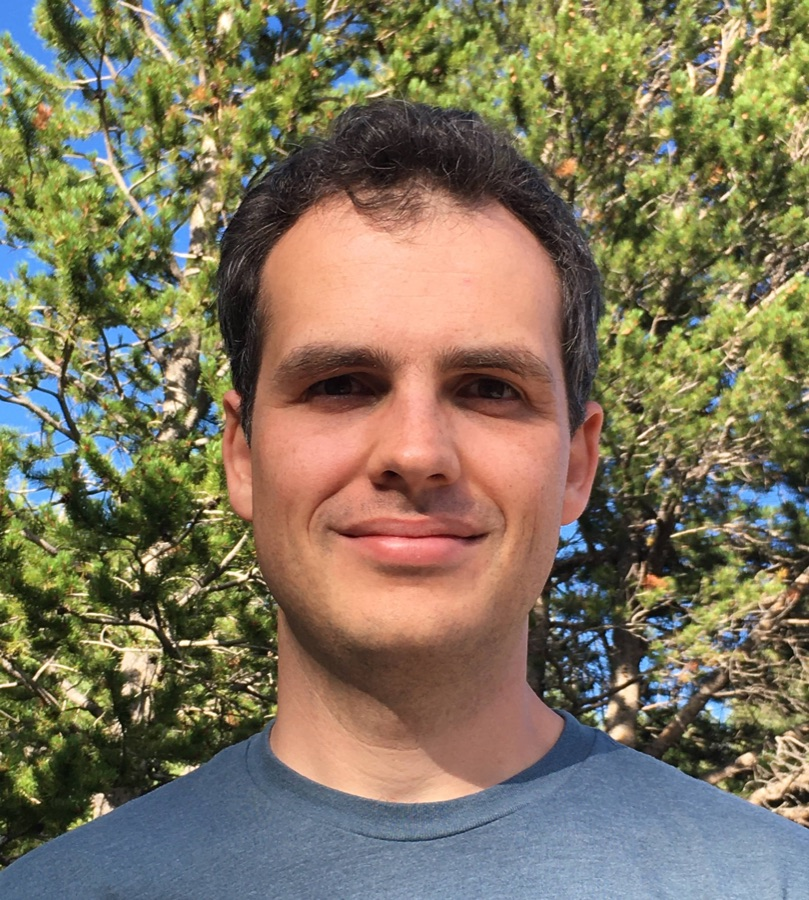

::::: intro

::: portrait
[{alt="Portrait of Job Leon Feldbrugge (opens CV)" width="809" height="900"}](Job_Feldbrugge_files/Literature/Job_Feldbrugge_CV.pdf){title="Curriculum Vitae (pdf)"}
:::

:::: intro-text

# Job Leon Feldbrugge

::: role
Postdoctoral Fellow, Leung Center for Cosmology and Particle Astrophysics, National Taiwan University\
Member, Institute for Advanced Study, Princeton
:::

I am a Postdoctoral Fellow at the [Leung Center for Cosmology and Particle Astrophysics](https://lecospa.ntu.edu.tw/) (LeCosPA) at [National Taiwan University](https://www.ntu.edu.tw/english/) in Taipei, and a Member of the [Institute for Advanced Study](https://www.ias.edu/) in Princeton. I am passionate about theoretical cosmology, theoretical physics in general, and mathematics.

I am interested in how abstract mathematics can deepen our understanding of observations and of the workings of our universe. Much of my current work uses Picard–Lefschetz theory and resurgence to define and evaluate real-time path integrals, with applications to quantum mechanics, wave optics in astrophysical lensing, and quantum cosmology. I also use catastrophe theory to describe the caustic skeleton of the cosmic web. See my [research page](research.html) for an overview.

Before moving to Taipei, I was a Higgs Fellow at the [Higgs Centre for Theoretical Physics](https://higgs.ph.ed.ac.uk/) at the [University of Edinburgh](https://www.ed.ac.uk/) (2021–2026), and before that held a joint postdoctoral position at the [Perimeter Institute for Theoretical Physics](https://perimeterinstitute.ca/) and [Carnegie Mellon University](https://www.cmu.edu/) (2019–2021). I obtained my PhD from the Perimeter Institute and the [University of Waterloo](https://uwaterloo.ca/physics-astronomy/) under the supervision of Neil Turok. I received bachelor and master degrees in Physics, Astronomy, and Mathematics from the [University of Groningen](https://www.rug.nl/) (Netherlands) and a master degree in Applied Mathematics (Part III) from the [University of Cambridge](https://www.cam.ac.uk/) (United Kingdom).

::: button-row
[Curriculum Vitae (pdf)](Job_Feldbrugge_files/Literature/Job_Feldbrugge_CV.pdf)
[Publication list (pdf)](Job_Feldbrugge_files/Literature/Feldbrugge_Publication_List.pdf)
:::

## Contact

::: address
Leung Center for Cosmology and Particle Astrophysics\
Chee-Chun Leung Cosmology Hall\
National Taiwan University\
No. 1, Sec. 4, Roosevelt Road\
Taipei 10617, Taiwan\
[jobfeldbrugge@ntu.edu.tw](mailto:jobfeldbrugge@ntu.edu.tw)
:::

::::

:::::
