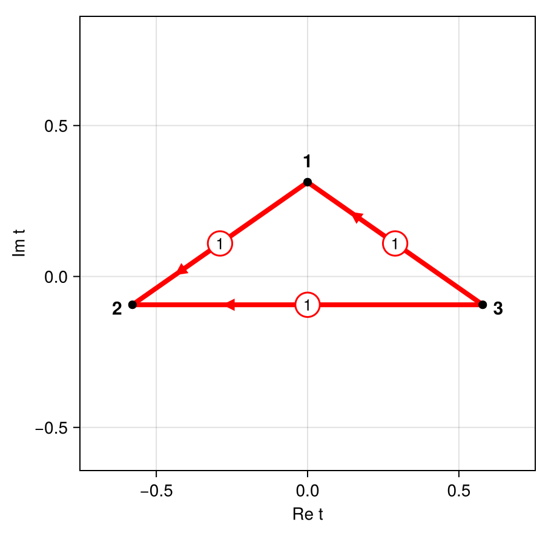
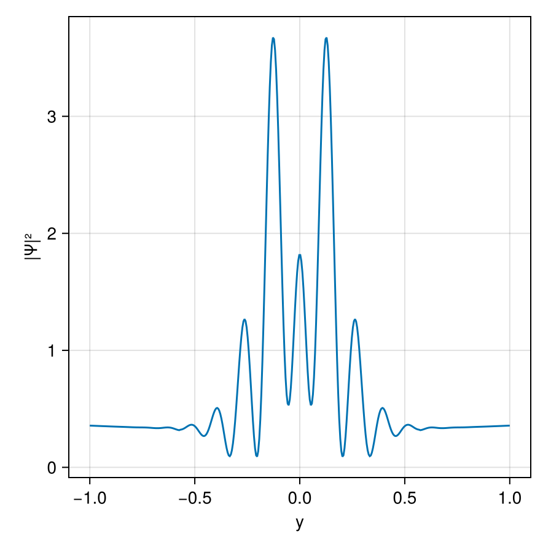
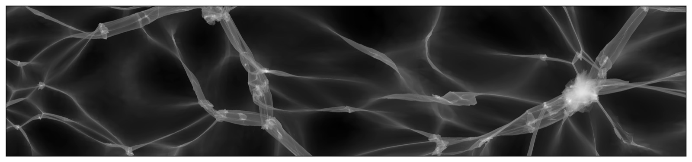
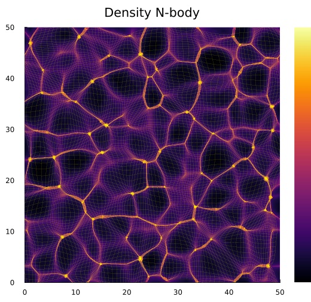
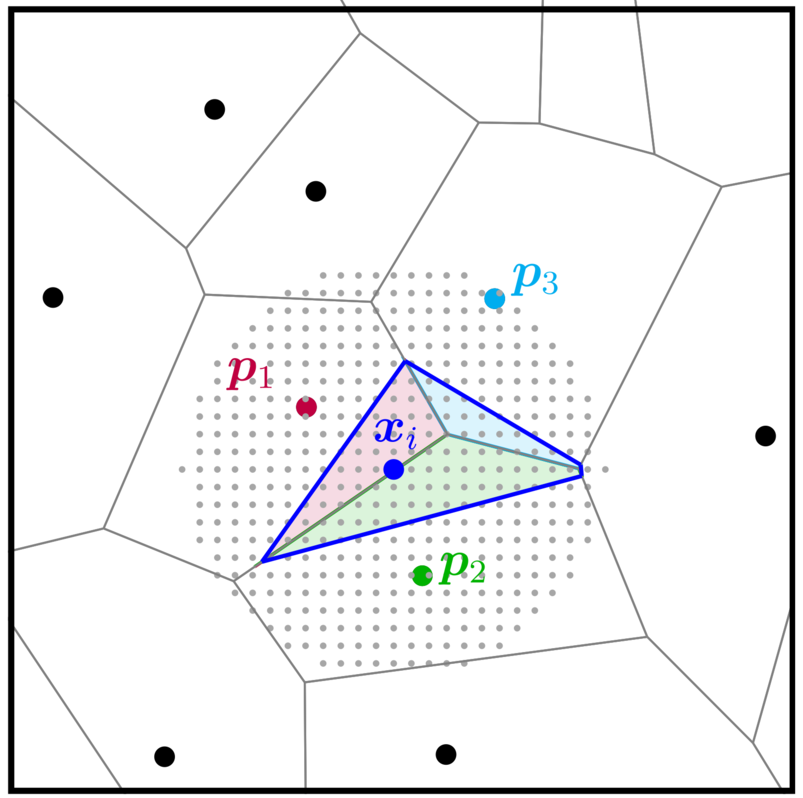

# Julia packages

::: lead
Open-source Julia packages that accompany my research. Each package is on GitHub, and the registered packages can be installed directly from the Julia package manager.
:::

## Resurgence.jl {#resurgence}

::: float-right
{alt="Adjacency graph of three saddle points in the Borel plane, with Stokes constants on the edges" width="910" height="890" loading="lazy"}
:::

Asymptotic evaluation of multidimensional oscillatory integrals with polynomial or rational exponents using resurgence. Integration by parts and Brieskorn reduction give the Gauss–Manin system of the exponent, which generates the asymptotic series of all saddle points. The monodromy of its Borel transform yields the Stokes constants and hence the adjacency of the saddle points. Combined with the [South-East rule](https://arxiv.org/abs/2606.28271), this identifies the relevant saddle points and gives superasymptotic and hyperasymptotic approximations without computing steepest-descent manifolds. The package accompanies [Asymptotic evaluation of multidimensional oscillatory integrals](https://arxiv.org/abs/2610.22767).

::: links
[GitHub](https://github.com/jfeldbrugge/Resurgence.jl)
:::

Not yet in the General registry; install it from GitHub:

```julia
pkg> add https://github.com/jfeldbrugge/Resurgence.jl
```

::: clear
:::

## PicardLefschetzIntegration.jl {#picard-lefschetz}

::: float-right
{alt="Interference pattern of a one-dimensional Lorentzian lens" width="910" height="890" loading="lazy"}
:::

Numerical evaluation of multidimensional oscillatory integrals with meromorphic exponents using Picard–Lefschetz theory. The integration domain is deformed in the complex plane onto the Lefschetz thimbles, where the integral converges absolutely and can be evaluated efficiently. It is a more accessible Julia implementation of the method behind my C++ [Picard–Lefschetz code](https://p-lpi.github.io/), with applications to [wave optics in astronomy](research.html#wave-optics).

::: links
[GitHub](https://github.com/jfeldbrugge/PicardLefschetzIntegration.jl) · [Documentation](https://jfeldbrugge.github.io/PicardLefschetzIntegration.jl/stable/)
:::

```julia
pkg> add PicardLefschetzIntegration
```

::: clear
:::

## PhaseSpaceDTFE.jl {#phase-space-dtfe}

{alt="Density field of the cosmic web in an N-body simulation" width="1600" height="376" loading="lazy"}

Estimates the density and velocity fields of an N-body simulation with the phase-space Delaunay tessellation field estimator, which follows the dark matter sheet in phase space and therefore resolves the multi-stream regions of the cosmic web. The package accompanies the paper [Phase-space Delaunay tessellation field estimator](https://arxiv.org/abs/2402.16234), published in Monthly Notices of the Royal Astronomical Society.

::: links
[GitHub](https://github.com/jfeldbrugge/PhaseSpaceDTFE.jl) · [Documentation](https://jfeldbrugge.github.io/PhaseSpaceDTFE.jl/stable/)
:::

```julia
pkg> add PhaseSpaceDTFE
```

## Nbody2D.jl {#nbody2d}

::: float-right
{alt="Density field of a two-dimensional cosmological N-body simulation showing the cosmic web" width="520" height="505" loading="lazy"}
:::

A particle-mesh code for two-dimensional cosmological N-body simulations, inspired by Johan Hidding's [nbody2d](https://zenodo.org/records/4158731) Python code. It is a quick environment to learn and experiment with cosmological N-body simulations: it samples unconstrained and constrained Gaussian random fields as initial conditions, evolves them to the present epoch, and estimates the density, velocity and number-of-streams fields with the phase-space Delaunay tessellation field estimator.

::: links
[GitHub](https://github.com/jfeldbrugge/Nbody2D.jl) · [Documentation](https://jfeldbrugge.github.io/Nbody2D.jl/stable/)
:::

```julia
pkg> add Nbody2D
```

::: clear
:::

## DiscreteNaturalNeighbors.jl {#discrete-natural-neighbors}

::: float-right
{alt="Voronoi cells of scattered data points with a grid of interpolation sites and the overlap regions of three neighbours" width="803" height="798" loading="lazy"}
:::

Discrete natural neighbour interpolation of n-dimensional data, developed by Benjamin Hertzsch in collaboration with me. Natural neighbour (Sibson) interpolation is a parameter-free, smooth and spatially adaptive way to interpolate a field from scattered data points, but it requires a new Voronoi tessellation for every interpolation site. Following [Park et al. (2006)](https://ieeexplore.ieee.org/document/1580458), the package replaces these volume calculations by in-cell counts on a discrete grid of interpolation sites, which makes the method practical for large data sets.

::: links
[GitHub](https://github.com/benhertzsch/DiscreteNaturalNeighbors.jl) · [Documentation](https://benhertzsch.github.io/DiscreteNaturalNeighbors.jl/stable/)
:::

```julia
pkg> add DiscreteNaturalNeighbors
```

::: clear
:::
