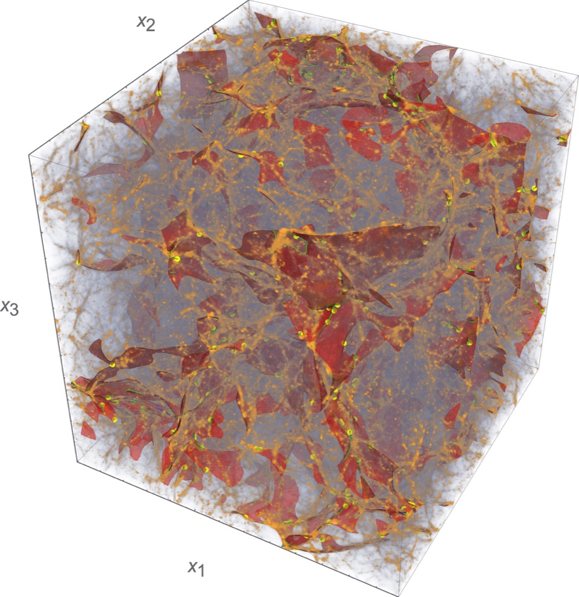
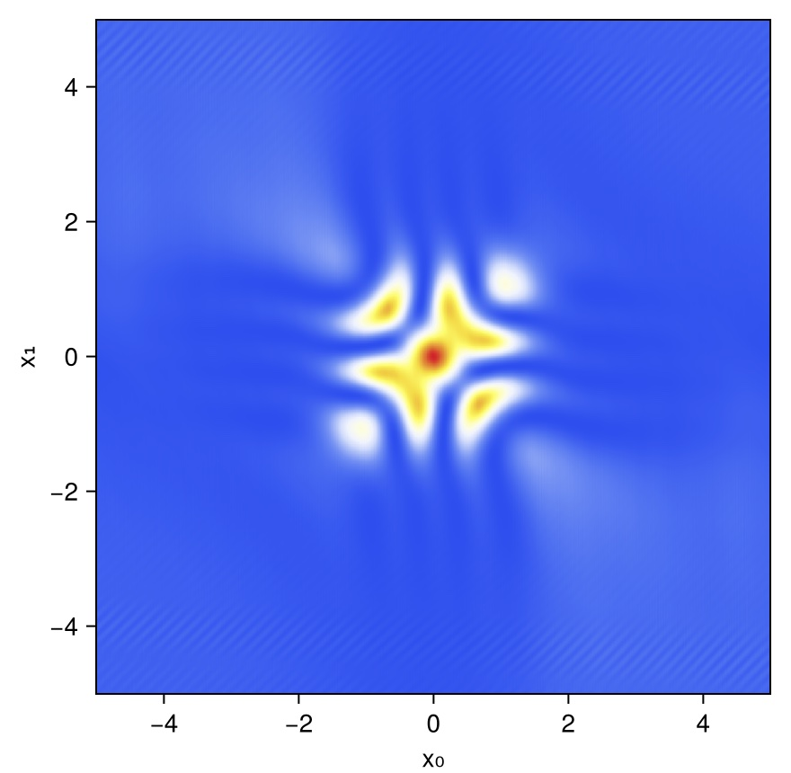
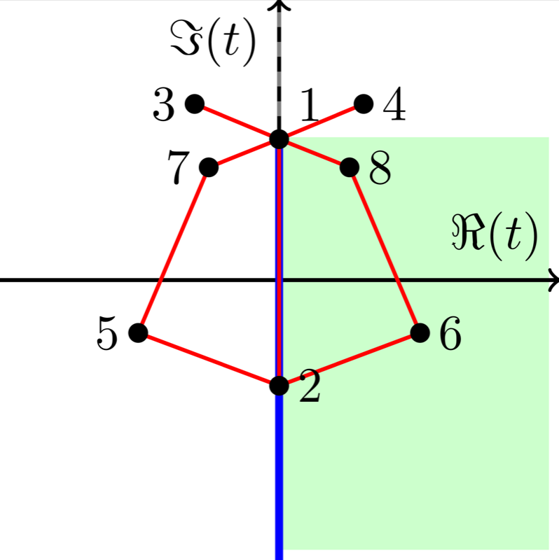
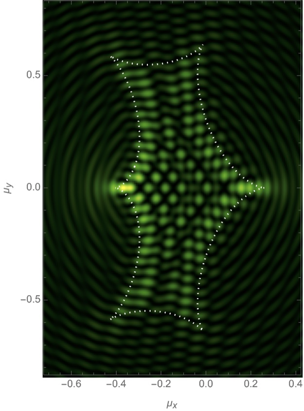

# Research

::: lead
I work at the interface of mathematics, theoretical physics and cosmology. A recurring theme is interference: whenever many paths contribute to a physical amplitude, the outcome is described by an oscillatory integral, and the most interesting physics often happens at caustics, where saddle points merge and the classical (geometric-optics) approximation breaks down, even though the integral itself remains finite.
:::

I use tools from complex analysis and singularity theory, including Picard–Lefschetz theory, resurgence and catastrophe theory, to make such integrals well defined and computable, and apply them to problems ranging from the formation of the cosmic web and radio astronomy to quantum mechanics and quantum cosmology. Throughout, I aim to study observable phenomena with conservative assumptions, in a critical and mathematically careful way. The [publications page](publications.html) has the complete list of papers.

## The caustic skeleton of the cosmic web {#cosmic-web}

::: float-right
{alt="Three-dimensional rendering of the caustic skeleton overlaid on the dark matter distribution in a simulation box" width="960" height="991"}
:::

Galaxies are organised in a cosmic web of clusters, filaments, walls and voids. Following the early work of Zel’dovich, Arnol’d and collaborators, I study this structure through the caustics that form as dark matter streams cross. Using Lagrangian catastrophe theory, formulated in terms of the eigenvalues and eigenvectors of the deformation tensor, the [caustic skeleton](https://arxiv.org/abs/1703.09598) identifies the elements of the cosmic web directly from the primordial density field.

Current work with Rien van de Weygaert and our students asks [what makes a cosmic filament](https://arxiv.org/abs/2405.20475) and whether [cosmic walls are real](https://arxiv.org/abs/2510.02419), builds [non-linear constrained realizations](https://arxiv.org/abs/2212.07840) and [statistics of the deformation eigenvalue fields](https://arxiv.org/abs/2301.07200), and connects the skeleton to observations: [galaxy populations in IllustrisTNG](https://arxiv.org/abs/2604.18209) and [the local cosmic web around the Coma cluster](https://arxiv.org/abs/2604.22213). To reconstruct density and velocity fields from simulations, I developed the [phase-space Delaunay tessellation field estimator](https://arxiv.org/abs/2402.16234).

::: clear
:::

## Real-time path integrals {#path-integrals}

::: float-right
{alt="Interference pattern in the real-time propagator for a particle in a potential well, plotted against initial and final position" width="880" height="860" loading="lazy"}
:::

Feynman’s path integral sums over all histories with an oscillating phase. In its original real-time (Lorentzian) form it is notoriously hard to define and to evaluate, which is why one usually Wick-rotates to imaginary time. Picard–Lefschetz theory offers an alternative: by deforming the integration domain into the complex plane onto the Lefschetz thimbles, the oscillatory integral becomes absolutely convergent and can be evaluated efficiently. In this picture the Wick rotation and the *iε* prescription emerge as special cases.

With collaborators I have used this approach to [establish the existence of real-time quantum path integrals](https://arxiv.org/abs/2207.12798), to [evaluate them efficiently](https://arxiv.org/abs/2501.16323), to describe [quantum reflection and tunnelling with complex classical paths](https://arxiv.org/abs/2309.12420) and [step potentials](https://arxiv.org/abs/2508.17578), and to understand what happens when saddle points [cross singularities](https://arxiv.org/abs/2309.12427). The same saddle-point methods also apply to [attosecond physics](https://arxiv.org/abs/2510.12545), where electrons are driven by strong laser fields.

These ideas grew out of my PhD work on **Lorentzian quantum cosmology** with Neil Turok and Jean-Luc Lehners. Using Picard–Lefschetz theory we reevaluated the [gravitational path integral](https://arxiv.org/abs/1703.02076) for the no-boundary and tunnelling proposals for the beginning of the universe, and found that, although well defined, they lead to [unacceptably large fluctuations](https://arxiv.org/abs/1705.00192).

::: clear
:::

## Resurgence and hyperasymptotics {#resurgence}

::: float-right
{alt="Sketch of the Borel plane with numbered critical points, the adjacency graph connecting them, the integration domain along the imaginary axis and the shaded South-East region" width="798" height="800" loading="lazy" .framed}
:::

Saddle-point expansions are typically divergent, and resurgence explains how: the late terms of the expansion around one saddle point encode the contributions of the others. Organising these contributions into a transseries and resumming it, by Borel or hyperasymptotic methods, turns a divergent series into approximations that are accurate to exponential order and come with error estimates.

A key difficulty is deciding which saddle points, real or complex, actually contribute to an integral. In Picard–Lefschetz theory this requires computing the flow lines of the integrand in the complexified domain, which quickly becomes impractical in many dimensions. With Inês Aniceto and Chris Howls I introduced the [South-East rule](https://arxiv.org/abs/2606.28271), a simple geometric algorithm that decides the relevance of saddle points from their positions in the Borel plane and their adjacency, without computing any flows. This is a step towards systematically identifying instanton contributions in real-time path integrals. In [recent work](https://arxiv.org/abs/2610.22767) with Samuel Crew, I developed an algebraic way to obtain the input for this rule: a finite-dimensional Gauss–Manin system generates the asymptotic expansions of all saddle points, and the monodromy of its Borel transform determines the Stokes constants and hence the adjacency of the saddles. Combined with the South-East rule, this yields superasymptotic and hyperasymptotic approximations without computing any gradient flows; the method is implemented in the Julia package Resurgence.jl. With Samuel Crew and Ue-Li Pen I also applied these ideas to [wave optics in astronomy](https://arxiv.org/abs/2602.21493), deriving the refractive expansion to all orders and resumming it to describe lensing at all frequencies.

::: clear
:::

## Wave optics in astronomy {#wave-optics}

::: float-right
{alt="Wave-optics intensity pattern of a binary gravitational lens, with interference fringes inside the caustic marked by a dotted white curve" width="625" height="845" loading="lazy"}
:::

When the wavelength of light is not small compared to the scales of a lens, geometric optics fails and lensing becomes an interference problem described by a Fresnel–Kirchhoff integral. This regime is directly relevant for radio astronomy, including pulsar scintillation and fast radio bursts, and for the gravitational lensing of gravitational waves.

I developed numerical methods based on Picard–Lefschetz theory for [oscillatory path integrals in radio astronomy](https://arxiv.org/abs/1909.04632), and applied them to [multi-plane lensing](https://arxiv.org/abs/2010.03089), [binary lenses](https://arxiv.org/abs/2008.01154) and [rotating stars](https://arxiv.org/abs/2410.03828), and to the [different regimes of astrophysical lensing](https://arxiv.org/abs/2204.12004). Most recently we have used [resurgence and hyperasymptotics](#resurgence) to describe wave-optics lensing at all frequencies. Related complex methods also give a way [beyond the Limber approximation](https://arxiv.org/abs/2304.13064) for angular power spectra. Code for one-dimensional integrals is available at [p-lpi.github.io](https://p-lpi.github.io/).

::: clear
:::

## Earlier work {#earlier}

During my bachelor and master studies in Groningen I studied the **topology of Gaussian random fields**, computing the statistics of connected components and loops (Betti numbers and persistence diagrams) of their excursion sets, with applications to the [cosmic microwave background and large-scale structure](https://arxiv.org/abs/1908.01619) and the [persistent homology of the cosmic web](https://arxiv.org/abs/2011.12851). With Neil Turok and Ue-Li Pen I also studied the non-linear evolution of the photon–baryon fluid, showing that its many acoustic oscillations lead to weak **shock waves in the early universe**.
